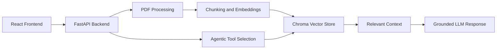

# DocQuery

> An evidence-grounded document question-answering assistant that combines semantic search, vector embeddings, and agentic tool selection.

DocQuery allows users to upload PDF documents and ask natural-language questions. The system retrieves relevant document passages, selects the appropriate tool, and generates answers grounded in the uploaded content with source references.

## Why DocQuery?

Traditional document search requires users to manually scan large files. DocQuery turns document interaction into a conversational workflow while preserving traceability through retrieved source chunks.

## Features

- Upload and process PDF documents
- Extract and chunk document text
- Generate vector embeddings for document passages
- Store and search embeddings using Chroma
- Retrieve the most relevant document chunks
- Use OpenAI function calling for dynamic tool selection
- Generate context-grounded answers
- Display source filenames and chunk references
- React-based user interface
- FastAPI backend with REST endpoints

## Architecture



## How It Works

1. A user uploads a PDF document.
2. The backend extracts the document text.
3. The text is divided into overlapping chunks.
4. Each chunk is converted into a vector embedding.
5. The embeddings and metadata are stored in Chroma.
6. The user submits a question through the React interface.
7. The agent selects the document-search tool.
8. Chroma retrieves the most relevant passages.
9. The LLM generates an answer using the retrieved context.
10. DocQuery returns the answer together with source references.

## Technology Stack

| Layer | Technology |
| --- | --- |
| Frontend | React, Vite |
| Backend | Python, FastAPI |
| LLM | OpenAI API |
| Embeddings | OpenAI Embeddings |
| Vector database | Chroma |
| Document processing | PyPDF |
| API communication | REST, JSON |
| Development tools | Git, GitHub |

## Project Structure

```text
DocQuery/
├── backend/
│   ├── app/
│   │   ├── main.py              # FastAPI application and API routes
│   │   ├── config.py            # Environment configuration
│   │   └── services/
│   │       ├── documents.py     # PDF extraction and text chunking
│   │       ├── vector_store.py  # Embeddings and Chroma retrieval
│   │       └── answering.py     # LLM responses and tool selection
│   ├── documents/               # Uploaded documents
│   ├── storage/                 # Local Chroma database
│   ├── requirements.txt
│   └── .env.example
│
├── frontend/
│   ├── src/
│   │   ├── main.jsx             # React application
│   │   └── styles.css           # Application styling
│   ├── package.json
│   └── index.html
│
├── .gitignore
└── README.md
```

## Getting Started

### Prerequisites

- Python 3.10 or later
- Node.js and npm
- An OpenAI API key
- Git

### 1. Clone the repository

```bash
git clone https://github.com/YOUR-USERNAME/DocQuery.git
cd DocQuery
```

### 2. Configure the backend

```bash
cd backend

python -m venv .venv
```

On Windows:

```bash
.venv\Scripts\activate
```

On macOS/Linux:

```bash
source .venv/bin/activate
```

Install the Python dependencies:

```bash
pip install -r requirements.txt
```

Create the environment file:

On Windows:

```bash
copy .env.example .env
```

On macOS/Linux:

```bash
cp .env.example .env
```

Add your API key to `backend/.env`:

```env
OPENAI_API_KEY=your_api_key_here
OPENAI_CHAT_MODEL=gpt-4.1-mini
OPENAI_EMBEDDING_MODEL=text-embedding-3-small
```

### 3. Start the backend

From the `backend` directory:

```bash
uvicorn app.main:app --reload
```

The FastAPI server will run at:

```text
http://localhost:8000
```

API documentation is available at:

```text
http://localhost:8000/docs
```

### 4. Start the frontend

Open a second terminal:

```bash
cd frontend
npm install
npm run dev
```

The React application will run at the local URL shown in the terminal, usually:

```text
http://localhost:5173
```

## API Endpoints

### Health check

```http
GET /health
```

### Upload a PDF

```http
POST /upload
```

Uploads a PDF, extracts its text, creates chunks, generates embeddings, and stores them in Chroma.

### Ask a question

```http
POST /ask
```

Example request:

```json
{
  "question": "What does the document say about the company’s revenue?"
}
```

Example response:

```json
{
  "answer": "The document reports that...",
  "sources": [
    {
      "filename": "annual_report.pdf",
      "chunk_index": 4
    }
  ]
}
```

## Engineering Highlights

- Designed an end-to-end RAG pipeline from document ingestion to answer generation
- Separated document processing, vector retrieval, and answer generation into modular services
- Added metadata to retrieved chunks for source traceability
- Used function calling to connect the LLM with document-search tools
- Implemented a React frontend and FastAPI backend as separate application layers
- Used persistent local Chroma storage for reusable document indexes

## Security

- Store API keys only in `.env`
- Never commit `.env` to GitHub
- Do not upload confidential or sensitive documents
- The `.gitignore` file excludes local secrets, uploaded documents, and vector-store data

## Roadmap

- Support DOCX and TXT files
- Add document deletion and management
- Add streaming responses
- Add conversation history
- Improve citation formatting
- Add automated evaluation for retrieval quality
- Benchmark retrieval latency across 10,000+ document chunks
- Add authentication and user-specific document collections
- Add Docker support and deployment configuration

## Author

**Navya Illa**
